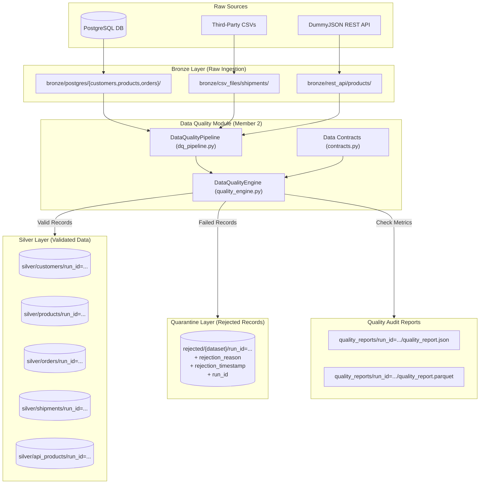

# DEPI Data Quality ETL Pipeline Platform

[](https://www.python.org/downloads/)
[](https://spark.apache.org/)
[](https://github.com/psf/black)
[](tests/)
[-teal.svg)](docs/architecture.md)

Production-grade, contract-driven Data Quality and ETL pipeline platform built with **PySpark**. Designed following the **Medallion Architecture**, it validates raw data ingested from heterogeneous sources (PostgreSQL relational tables, external CSV files, and REST API JSON payloads), enforces declarative **Data Contracts**, quarantines corrupted and non-compliant records with actionable rejection reasons and timestamps, outputs clean validated data into **Silver Parquet tables**, and generates standardized audit reports in both **JSON** and **Parquet** formats.

---

## 📑 Table of Contents

- [Key Features](#-key-features)
- [Architecture Overview](#-architecture-overview)
- [Supported Datasets & Contracts](#-supported-datasets--contracts)
- [Quality Check Suite](#-quality-check-suite)
- [Directory Layout](#-directory-layout)
- [Quick Start & Installation](#-quick-start--installation)
- [Running the Quality Pipeline](#-running-the-quality-pipeline)
- [Quality Reports & Metrics](#-quality-reports--metrics)
- [Testing & Verification](#-testing--verification)
- [Documentation Index](#-documentation-index)
- [License](#-license)

---

## 🚀 Key Features

- **Contract-Driven Data Quality Engine**: Declarative schema, nullability, uniqueness, range, future-date, and referential integrity constraints defined per dataset.
- **Safe Type Casting**: Leverages PySpark `try_cast` with custom error tracking so invalid cast values (e.g. `'abc'` in an integer column) are quarantined with descriptive reasons instead of causing pipeline crashes or silent conversions.
- **Cascading Referential Integrity**: Validates foreign keys against **Silver parent datasets** rather than raw Bronze data, ensuring orphans caused by parent rejections are safely isolated.
- **Quarantine Isolation & Auditability**: Every rejected record is preserved in `rejected/<dataset>/run_id=<id>/` in Parquet format with `run_id`, `rejection_reason`, and `rejection_timestamp`.
- **Dual-Format Audit Reports**: Generates exhaustive quality metrics for every rule execution in both human-readable JSON (`quality_reports/run_id=<id>/quality_report.json`) and queryable columnar Parquet (`quality_reports/run_id=<id>/quality_report.parquet`).
- **Idempotent & Multi-Run Safe**: Partitioned by `run_id` across Bronze, Silver, Quarantine, and Reports. Re-running a `run_id` overwrites cleanly without duplication or cross-run pollution.
- **Heterogeneous Source Ingestion Support**: Handles multi-line nested JSON arrays from REST APIs, date-partitioned CSV files from relational databases, and flat CSV files.

---

## 🏛 Architecture Overview

The platform implements a Medallion Lakehouse Architecture pattern:



For in-depth architectural specifications and storage partitioning diagrams, see [docs/architecture.md](docs/architecture.md).

---

## 📦 Supported Datasets & Contracts

The platform enforces rigorous Data Contracts across all 5 business entities:

| Dataset | Source Type | Primary Key | Key Validations Enforced |
| :--- | :--- | :--- | :--- |
| **`postgres.customers`** | CSV (PostgreSQL) | `customer_id` | Unique ID, non-null & non-empty `email`, non-empty `name`, country string check. |
| **`postgres.products`** | CSV (PostgreSQL) | `product_id` | Unique ID, non-null & non-empty `name`, `price > 0.0`. |
| **`postgres.orders`** | CSV (PostgreSQL) | `order_id` | Unique ID, non-null foreign keys, RI to Silver `customers` & `products`, `quantity > 0`, `amount > 0.0`, `order_date <= current_date`. |
| **`csv_files.shipments`** | CSV (Filesystem) | `shipment_id` | Unique ID, RI to Silver `orders`, non-null & non-empty `carrier`, `delivery_days >= 0`. |
| **`rest_api.products`** | JSON (REST API) | `id` | Unique ID, non-null & non-empty `title`, `price >= 0.0`, `stock >= 0`, `0.0 <= rating <= 5.0`. |

Detailed contract parameters, thresholds, and schemas are documented in [docs/data-contracts.md](docs/data-contracts.md).

---

## 🛡 Quality Check Suite

The core `DataQualityEngine` executes 6 primary dimensions of data quality:

1. **Schema & Safe Type Validation**: Validates column existence and performs safe casting with `try_cast`, catching corrupt input data before downstream failures occur.
2. **Null & Empty String Validation**: Checks for `NULL` values and flags whitespace-only/empty strings using `trim(col) == ''`.
3. **Duplicate Detection**: Enforces primary key uniqueness using window functions (`ROW_NUMBER() OVER (PARTITION BY key)`), isolating all duplicate rows into quarantine.
4. **Referential Integrity (RI)**: Performs left anti-joins against validated reference tables in Silver to detect and isolate orphan child records. Supports mismatched column names (`fk_col != ref_col`).
5. **Open-Ended & Closed Range Validation**: Validates numerical boundaries (`min_val`, `max_val`, inclusive/exclusive bounds).
6. **Date & Future Date Validation**: Validates date formats and rejects impossible future dates using dynamic comparison against `current_date()`.
7. **Row Count Thresholds**: Monitors volume drops against configurable minimum row counts.

Complete engine design and algorithms are detailed in [docs/data-quality.md](docs/data-quality.md).

---

## 📂 Directory Layout

```
Data-Quality-Pipeline-Platform/
├── bronze/                         # Raw ingested datasets (source-of-truth)
│   ├── postgres/                   # customers/, products/, orders/
│   ├── csv_files/                  # shipments/
│   └── rest_api/                   # products/
├── silver/                         # Clean, validated Parquet tables partitioned by run_id
├── rejected/                       # Quarantined records with reasons & timestamps
├── quality_reports/                # Execution audit reports (JSON & Parquet)
├── src/
│   ├── extraction/                 # Ingestion module (Member 1)
│   │   ├── ingestion.py            # Extraction orchestrator (PG, CSV, REST API)
│   │   └── sample_shipments.csv    # Source CSV generator
│   └── validation/                 # Data Quality module (Member 2)
│       ├── quality_engine.py       # Core PySpark DataQualityEngine
│       ├── contracts.py            # Declarative Data Contracts & Schemas
│       └── dq_pipeline.py          # End-to-end DataQualityPipeline orchestrator
├── tests/
│   ├── conftest.py                 # PySpark test fixtures & environment setup
│   ├── test_quality_engine.py      # 10 comprehensive unit tests
│   └── test_dq_pipeline.py         # 5 end-to-end & edge-case integration tests
├── docs/                           # Technical documentation suite
│   ├── architecture.md             # System & Medallion architecture
│   ├── data-quality.md             # Quality engine mechanics & check suite
│   ├── data-contracts.md           # Contract definitions & schemas
│   ├── pipeline-usage.md           # Operational manual & CLI execution
│   ├── testing.md                  # Testing strategy & execution logs
│   └── project-structure.md        # File system anatomy & responsibilities
├── pytest.ini                      # Test runner configuration
├── requirements.txt                # Production and test dependencies
└── README.md                       # Main project documentation
```

---

## ⚡ Quick Start & Installation

### Prerequisites

- **Python**: 3.10 to 3.14
- **Java**: JRE/JDK 11 or 17 (Required by Apache Spark)
- **Hadoop Winutils** (Windows only): `winutils.exe` and `hadoop.dll` configured under `HADOOP_HOME`.

### Setup Environment

```bash
# Clone repository
git clone https://github.com/your-repo/Data-Quality-Pipeline-Platform.git
cd Data-Quality-Pipeline-Platform

# Create and activate virtual environment
python -m venv .venv
source .venv/bin/activate  # On Windows: .venv\Scripts\Activate.ps1

# Install dependencies
pip install -r requirements.txt
```

---

## 💻 Running the Quality Pipeline

### Programmatic Python Usage

```python
from pyspark.sql import SparkSession
from src.validation.dq_pipeline import DataQualityPipeline

# Initialize Spark Session
spark = (
    SparkSession.builder
    .appName("DEPI-DataQualityPipeline")
    .master("local[*]")
    .config("spark.sql.session.timeZone", "UTC")
    .getOrCreate()
)

# Initialize and run pipeline
pipeline = DataQualityPipeline(
    spark=spark,
    bronze_dir="bronze",
    silver_dir="silver",
    rejected_dir="rejected",
    reports_dir="quality_reports",
)

# Execute against latest run or a specific run_id
summary = pipeline.run_pipeline(run_id="8f488fe2")

print(f"Status: {summary['status']}")
print(f"Datasets: {summary['datasets']}")
print(f"Reports saved to: {summary['report_json']}")
```

For CLI invocation and Airflow scheduling patterns, see [docs/pipeline-usage.md](docs/pipeline-usage.md).

---

## 📊 Quality Reports & Metrics

Every run generates audit reports containing 10 standardized fields:

```json
[
  {
    "run_id": "8f488fe2",
    "pipeline_name": "DataQualityPipeline",
    "task_name": "validate_shipments",
    "check_name": "null",
    "check_status": "FAILED",
    "records_checked": 301,
    "records_failed": 7,
    "threshold": "allow_nulls=False",
    "execution_timestamp": "2026-11-23 00:42:37",
    "error_message": "Column 'carrier' has 7 NULL or empty values"
  }
]
```

---

## 🧪 Testing & Verification

The suite includes 15 automated PySpark tests with 100% pass rate:

```bash
# Run the complete test suite
pytest -v
```

```
tests/test_dq_pipeline.py::test_end_to_end_pipeline_execution PASSED
tests/test_dq_pipeline.py::test_pipeline_idempotency PASSED
tests/test_dq_pipeline.py::test_multiple_run_id_isolation PASSED
tests/test_dq_pipeline.py::test_missing_dataset_handling PASSED
tests/test_dq_pipeline.py::test_empty_dataframe_handling PASSED
tests/test_quality_engine.py::test_all_quality_rules PASSED
tests/test_quality_engine.py::test_row_count_failure PASSED
tests/test_quality_engine.py::test_internal_column_name_conflicts PASSED
tests/test_quality_engine.py::test_schema_failure PASSED
tests/test_quality_engine.py::test_empty_string_validation PASSED
tests/test_quality_engine.py::test_open_ended_ranges PASSED
tests/test_quality_engine.py::test_date_range_and_future_dates PASSED
tests/test_quality_engine.py::test_referential_integrity_different_keys PASSED
tests/test_quality_engine.py::test_contracts_definitions PASSED
tests/test_quality_engine.py::test_safe_cast_prevents_silent_loss PASSED

======================= 15 passed in 561.57s (0:09:21) ========================
```

---

## 📚 Documentation Index

- [Architecture Guide](docs/architecture.md): Medallion flow, lineage, storage hierarchy, and error recovery.
- [Data Quality Engine](docs/data-quality.md): Detailed mechanics of all 6 checks, safe cast expressions, and reporting.
- [Data Contracts Reference](docs/data-contracts.md): Complete specifications for all 5 dataset schemas and validation rules.
- [Pipeline Usage Manual](docs/pipeline-usage.md): Step-by-step CLI execution, configuration, and Airflow orchestration.
- [Testing Guide](docs/testing.md): Unit/Integration test suites, fixtures, CI/CD validation, and verified run outputs.
- [Project Structure](docs/project-structure.md): Detailed anatomy of all project directories, scripts, and modules.

---

## 📄 License

This project is developed as part of the Digital Egypt Pioneers Initiative (DEPI) Data Engineering track. All rights reserved.
