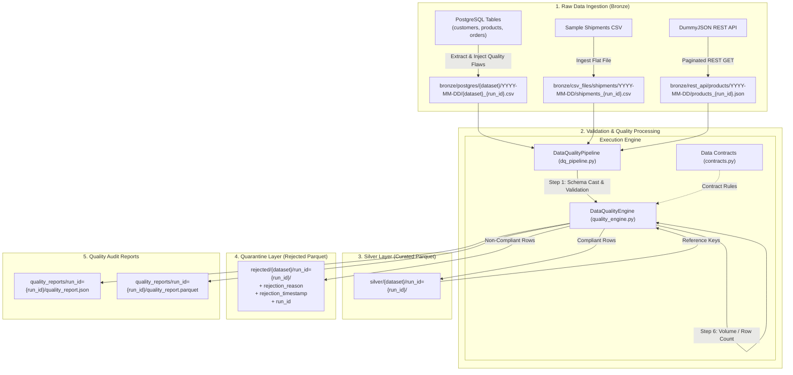
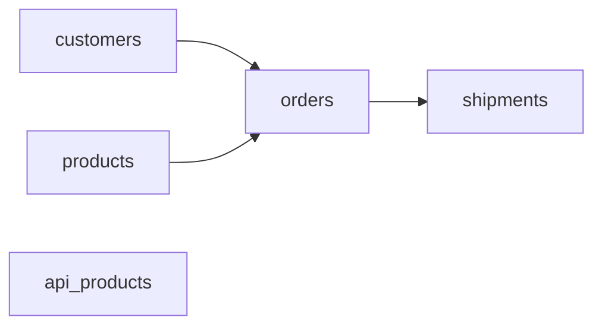

# System Architecture & Technical Design

## 1. Architectural Philosophy

The **DEPI Data Quality Pipeline Platform** is designed following the **Medallion Lakehouse Architecture** (Bronze → Silver), emphasizing immutable raw data storage, declarative data contracts, auditable quarantine mechanisms, and decoupled processing components.

The platform guarantees:
- **Zero Silent Data Loss**: All corrupted or non-compliant records are retained in a dedicated quarantine zone with explicit error explanations.
- **Strict Idempotency**: Running a pipeline multiple times for the same batch/run does not duplicate records or create inconsistent state.
- **Deterministic Referential Integrity**: Foreign keys are evaluated against verified Silver datasets to prevent dirty records from cascading downstream.
- **Auditable Lineage**: Every valid or invalid row is traceable back to its originating `run_id` and raw ingestion batch.

---

## 2. End-to-End Data Pipeline Flow

---

## 3. Storage Hierarchy & Medallion Layers

### Bronze Layer (Raw & Immutable)
- **Path**: `bronze/{source_type}/{dataset}/{YYYY-MM-DD}/{dataset}_{run_id}.{csv|json}`
- **Nature**: Raw bytes ingested directly from sources. Ingestion metadata (`_ingested_at`, `_run_id`, `_source`) is either embedded or derived from path conventions.
- **Format**: CSV (comma-delimited, header present) and JSON (multi-line or array payloads).

### Silver Layer (Clean & Conformed)
- **Path**: `silver/{dataset}/run_id={run_id}/`
- **Nature**: Typed, validated, and deduplicated datasets. Ready for analytical consumption, feature stores, or downstream Gold dimensional modeling.
- **Format**: Optimized Columnar Apache Parquet with Snappy compression.
- **Partitioning**: Partitioned by `run_id` to guarantee batch isolation.

### Quarantine / Rejected Layer
- **Path**: `rejected/{dataset}/run_id={run_id}/`
- **Nature**: Quarantined records that violated one or more contract rules. Preserves the full original record attributes alongside:
  - `rejection_reason` (string): Human-readable error message explaining why the record failed (e.g. `'carrier cannot be NULL'`, `'price must be > 0.0'`).
  - `rejection_timestamp` (timestamp): Exact UTC timestamp when the failure was registered.
  - `run_id` (string): Batch run identifier.
- **Format**: Apache Parquet.

### Quality Reports Layer
- **Path**: `quality_reports/run_id={run_id}/`
- **Nature**: Aggregated execution telemetry for data observability and SLA alerting.
- **Format**: Dual-written in both JSON (for web UI or alert webhooks) and Parquet (for historical metric trends and SQL queries).

---

## 4. Processing Order & Cascading Integrity

Data quality validation follows a strict topological dependency order to ensure parent reference keys are available before dependent child datasets are validated:

1. **`postgres.customers`**: Validated and written to `silver/customers/run_id={run_id}/`.
2. **`postgres.products`**: Validated and written to `silver/products/run_id={run_id}/`.
3. **`postgres.orders`**: Evaluates foreign keys against **Silver Customers** (`customer_id`) and **Silver Products** (`product_id`). Any order referencing an invalid or non-existent parent is immediately quarantined as an orphan.
4. **`csv_files.shipments`**: Evaluates foreign keys against **Silver Orders** (`order_id`). Any shipment referencing an invalid or non-existent order is quarantined.
5. **`rest_api.products`**: Validated as an independent catalog dataset and saved to `silver/api_products/run_id={run_id}/`.

---

## 5. Fault Tolerance & Idempotency Design

### Safe Casting Mechanism
Traditional PySpark `.cast(IntegerType())` produces runtime exceptions under Spark 3.0+ ANSI mode when encountering malformed inputs like `"invalid_num"`.

The platform implements an error-safe two-stage casting pattern:
1. Pre-evaluates castability using custom expressions:
   `_dq_cast_err_col = (col.isNotNull()) & (try_cast(col as type).isNull())`
2. Rows triggering cast errors are flagged and isolated to Quarantine with reason:
   `"Invalid data type for column <col>: cannot cast value to <type>"`
3. The remaining values are converted safely via `try_cast`.

### Idempotency Strategy
- All writer operations in `DataQualityPipeline` utilize `.mode("overwrite")` targeting specific partition directories (`run_id=<run_id>`).
- If a pipeline step is retried or executed twice with the same `run_id`, previous partial files are atomically replaced without duplicating records or corrupting reports.
