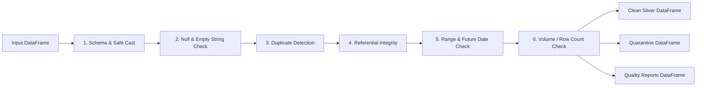

# Data Quality Engine Mechanics & Rules

## 1. Engine Architecture

The `DataQualityEngine` (`src/validation/quality_engine.py`) is the core computational module of the platform. Built entirely on **PySpark**, it executes declarative validation suites against distributed DataFrames while maintaining high performance, minimal shuffles, and complete backwards compatibility.

### Core Signature
```python
engine = DataQualityEngine(spark_session)
clean_df, rejected_df, reports_df = engine.validate(
    df=bronze_df,
    rules=contract_rules,
    run_id=batch_run_id,
    task_name="validate_orders"
)
```

---

## 2. Validation Check Suite

The engine enforces 6 core validation categories, each mapping to a distinct data quality dimension:



---

### Check 1: Schema & Safe Type Validation
- **Objective**: Ensure that required columns exist with the expected data types without dropping malformed records unrecorded.
- **Implementation**:
  - Validates that all columns defined in `contract.schema` exist in the incoming DataFrame.
  - Generates custom rule flags using `try_cast` to catch strings that cannot be parsed into numeric, decimal, or date formats.
  - Quarantines invalid rows with reason: `"Invalid data type for column <col>: cannot cast value to <type>"`.

### Check 2: NULL & Empty String Validation
- **Objective**: Prevent missing mandatory values from corrupting analytics.
- **Rule Syntax**:
  ```python
  "null_checks": [
      {"column": "email", "allow_null": False, "reject_empty_string": True},
      {"column": "name", "allow_null": False, "reject_empty_string": True}
  ]
  ```
- **Implementation**:
  - `col.isNull()` identifies literal null values.
  - `trim(col) == ''` identifies strings consisting entirely of whitespace or empty strings.
  - Distinct reasons are tagged: `"<col> cannot be NULL"` or `"<col> cannot be empty"`.

### Check 3: Duplicate Detection
- **Objective**: Guarantee entity uniqueness on natural and surrogate keys.
- **Rule Syntax**:
  ```python
  "duplicate_checks": [
      {"columns": ["customer_id"]}
  ]
  ```
- **Implementation**:
  - Utilizes PySpark Window functions:
    ```python
    window_spec = Window.partitionBy(*cols).orderBy(F.lit(1))
    df = df.withColumn("_row_num", F.row_number().over(window_spec))
    ```
  - All duplicate occurrences (`_row_num > 1` or all matching rows depending on strictness) are flagged and routed to quarantine with `"Duplicate record"`.

### Check 4: Referential Integrity (RI)
- **Objective**: Guarantee that relationships between business entities are valid.
- **Rule Syntax**:
  ```python
  "referential_integrity": [
      {
          "foreign_key": "customer_id",
          "reference_key": "customer_id",
          "reference_df": silver_customers_df,
          "relationship_name": "orders_to_customers"
      }
  ]
  ```
- **Implementation**:
  - Supports mismatched column names (`foreign_key != reference_key`).
  - Executes a broadcast or shuffle left anti-join against the reference DataFrame:
    ```python
    orphans = df.join(
        ref_df.select(ref_key).distinct(),
        df[fk] == ref_df[ref_key],
        how="left_anti"
    )
    ```
  - Isolates orphan records with reason: `"Foreign key <fk> has no matching reference in <relationship>"`.

### Check 5: Range & Date Constraints
- **Objective**: Prevent impossible numerical quantities and future dates.
- **Rule Syntax**:
  ```python
  "range_checks": [
      {"column": "price", "min_value": 0.0, "inclusive_min": False},  # price > 0
      {"column": "rating", "min_value": 0.0, "max_value": 5.0},       # 0 <= rating <= 5
      {"column": "order_date", "max_value": "current_date"}            # no future dates
  ]
  ```
- **Implementation**:
  - Supports open-ended boundaries (`min_value` only, `max_value` only, or bounded intervals).
  - Configurable boundary inclusion (`inclusive_min=True/False`, `inclusive_max=True/False`).
  - Dynamic evaluation for date keywords (`"current_date"` is evaluated via `F.current_date()`).

### Check 6: Row Count & Threshold Validation
- **Objective**: Protect against empty or severely truncated extraction runs.
- **Rule Syntax**:
  ```python
  "row_count_checks": [
      {"min_rows": 1, "max_rows": 1000000}
  ]
  ```
- **Implementation**:
  - Records execution metrics in `quality_reports`.
  - Flags the task status as `FAILED` if volume thresholds are breached.

---

## 3. Standardized Quality Report Schema

Every execution produces audit rows adhering to the unified 10-column contract:

| Column Name | Data Type | Description |
| :--- | :--- | :--- |
| `run_id` | String | Unique batch execution ID |
| `pipeline_name` | String | Name of orchestrating pipeline (`"DataQualityPipeline"`) |
| `task_name` | String | Specific validation task (`"validate_customers"`, etc.) |
| `check_name` | String | Category (`schema`, `null`, `duplicate`, `range`, etc.) |
| `check_status` | String | Status (`"PASSED"` or `"FAILED"`) |
| `records_checked` | BigInt | Total input records processed |
| `records_failed` | BigInt | Number of records violating this rule |
| `threshold` | String | Rule criteria string (e.g. `"min_value=0.0"`) |
| `execution_timestamp` | String | UTC Timestamp formatted as `YYYY-MM-DD HH:MM:SS` |
| `error_message` | String | Contextual failure details or `"Check passed successfully"` |
