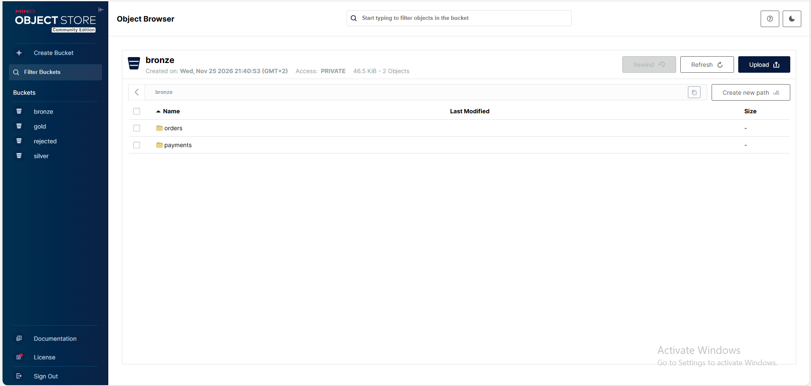
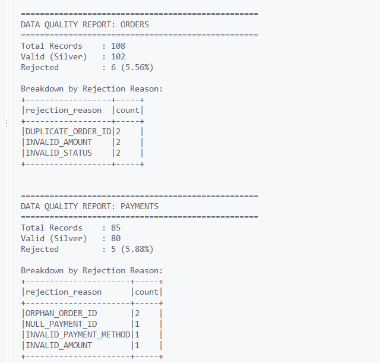

# E-Commerce Data Quality ELT Pipeline

An end-to-end batch **ELT (Extract, Load, Transform)** data engineering pipeline built with a **Medallion Architecture** (`Bronze` -> `Silver` -> `Gold`) and automated **Data Quality Gates & Quarantine Isolation** for an e-commerce domain (Orders & Payments).

---

## Table of Contents

1. [Project Overview & Architecture](#1-project-overview--architecture)
2. [Key Architectural Decisions](#2-key-architectural-decisions)
3. [Repository Structure](#3-repository-structure)
4. [Infrastructure Stack](#4-infrastructure-stack)
5. [Pipeline Stages & Data Quality Rules](#5-pipeline-stages--data-quality-rules)
6. [Execution Evidence & Verification](#6-execution-evidence--verification)
7. [Step-by-Step Reproducibility Guide (For Team Members)](#7-step-by-step-reproducibility-guide-for-team-members)
8. [Troubleshooting Common Issues](#8-troubleshooting-common-issues)
9. [Team Handoff Guide (What to Build Next)](#9-team-handoff-guide-what-to-build-next)

---

## 1. Project Overview & Architecture

Modern analytics platforms cannot rely on fragile pipelines that crash when upstream systems emit malformed records. This project demonstrates a production-style **ELT pipeline** that lands raw operational data as-is into an S3-compatible object store (**MinIO**), then executes distributed validation, deduplication, referential integrity checks, and quarantine routing using **Apache Spark (PySpark)**.

```text
[Source Systems]                  [Bronze Layer - Raw]            [Data Quality Gate]           [Curated & Quarantine]
+-----------------+               +--------------------+          +-------------------+          +---------------------+
| PostgreSQL DB   |--(Extract)--->| MinIO: bronze/     |          |                   |-(Valid)->| MinIO: silver/      |
| (orders table)  |   NDJSON      |  |- orders/        |          |   Apache Spark    |          |  (Parquet)          |
+-----------------+               |                    |--(Read)->|   (PySpark DQ)    |          +---------------------+
                                  |                    |          |                   |
+-----------------+               |                    |          |  * Null Checks    |          +---------------------+
| Payments API    |--(Paginated)->|  |- payments/      |          |  * Deduplication  |-(Fail)-->| MinIO: rejected/    |
| (Simulated)     |   NDJSON      |                    |          |  * Domain Rules   |          |  (Parquet + Reason) |
+-----------------+               +--------------------+          |  * FK Integrity   |          +---------------------+
                                                                  +-------------------+
```

---

## 2. Key Architectural Decisions

* **ELT over Traditional ETL:** Raw records are landed untouched in the `bronze` bucket as **NDJSON** (*Schema-on-Read*). This guarantees zero data loss on schema drift or malformed fields and preserves an immutable audit trail for replayability.
* **Decoupled Source Ingestion:** Database extraction (`orders`) and API extraction (`payments`) are separated into independent scripts. If the external Payments API experiences downtime or rate-limiting, the PostgreSQL ingestion succeeds independently.
* **Resilient API Patterns & Metadata Enrichment:** The API ingestion implements pagination and retry logic with exponential backoff, and both extractors tag every record with `_ingested_at` and `_source` lineage metadata.
* **Format Optimization by Layer:**
  * **Bronze (`NDJSON`):** Human-readable, schema-flexible, fast ingestion.
  * **Silver & Rejected (`Parquet`):** Strongly typed, columnar, compressed, and Hive-partitioned (`ingestion_date=YYYY-MM-DD`) for high-performance downstream analytics.
* **Intentional Fault Injection:** Synthetic anomalies (null keys, negative/zero amounts, invalid statuses, duplicate order IDs, null payment methods, and orphan payments) are systematically injected at the source to verify that every Data Quality Gate catches bad records accurately.

---

## 3. Repository Structure

```text
Data-Quality-Pipeline-Platform/
├── dags/                              # Apache Airflow DAGs (Phase 3)
├── dashboards/                        # Power BI batch & DQ reporting dashboards (Phase 4)
├── data/                              # Local sample/reference data assets
├── docs/                              # Architecture notes & supplementary documentation
├── sql/                               # Analytical SQL & target schema scripts
├── src/
│   ├── seed_db.py                     # Seeds PostgreSQL with synthetic orders + injected anomalies
│   ├── postgers_ingestion.py          # Extracts orders from PostgreSQL -> MinIO Bronze (NDJSON)
│   ├── api_ingestion_to_minio.py      # Fetches paginated payments API -> MinIO Bronze (NDJSON)
│   └── dq_bronze_to_silver.py         # PySpark DQ validation, deduplication & quarantine routing
├── tests/                             # Unit tests for data quality rules
├── work_evidence/
│   └── Ahmed/
│       ├── 1-Landed_data_to_minio.png # Proof of Bronze layer ingestion in MinIO
│       └── Data_quality_result.png    # Proof of PySpark DQ metrics & quarantine breakdown
├── docker-compose.yml                 # Containerized multi-service infrastructure stack
├── depi_project_documentation.pdf     # Full project documentation (DEPI)
└── README.md
```

---

## 4. Infrastructure Stack

All core services are containerized via `docker-compose.yml` with explicit memory limits (`mem_limit`), health checks, and an isolated bridge network (`dq_network`):

| Service | Container Name | Host Port(s) | Memory Limit | Purpose |
| :--- | :--- | :--- | :--- | :--- |
| **PostgreSQL 15** | `dq_postgres` | `5432` | `512m` | Source operational DB (`orders`) & Airflow metadata store |
| **Adminer** | `dq_adminer` | `8082` | `128m` | Lightweight web UI to inspect PostgreSQL tables |
| **MinIO** | `dq_minio` | `9000` (API), `9001` (UI) | `512m` | S3-compatible object storage (`bronze`, `silver`, `gold`, `rejected`) |
| **Spark Master** | `dq_spark_master` | `8080` (UI), `7077` (RPC) | `1g` | Distributed Spark master node (optional for local mode) |
| **Spark Worker** | `dq_spark_worker` | Internal | `1536m` | Distributed Spark worker node (optional for local mode) |
| **Apache Airflow** | `dq_airflow` | `8081` | `1536m` | Workflow orchestrator (Phase 3) |

---

## 5. Pipeline Stages & Data Quality Rules

### Stage 1: Source Seeding (`src/seed_db.py`)
Generates synthetic e-commerce orders and loads them into the operational PostgreSQL `orders` table with intentional fault injection:
* Null `order_id` and null `customer_id`
* Negative and zero `total_amount`
* Invalid order statuses (`INVALID_STATE`, `BROKEN`)
* Duplicate `order_id` records

### Stage 2: Decoupled Bronze Ingestion
* **`src/postgers_ingestion.py`:** Extracts raw orders from PostgreSQL, enriches each record with `_ingested_at` and `_source`, and lands NDJSON at:
  `s3a://bronze/orders/ingestion_date=YYYY-MM-DD/raw_orders.json`
* **`src/api_ingestion_to_minio.py`:** Simulates a paginated Payments Gateway API with retry/exponential backoff (including orphan `order_id`s, null `payment_method`, negative `amount`, and null `payment_id`), and lands NDJSON at:
  `s3a://bronze/payments/ingestion_date=YYYY-MM-DD/raw_payments.json`

### Stage 3: PySpark Data Quality Gate & Quarantine (`src/dq_bronze_to_silver.py`)
Reads raw NDJSON from `bronze` using `hadoop-aws` (`s3a://`), applies rule-based validation, and splits output into `silver` (clean Parquet) and `rejected` (quarantined Parquet with `rejection_reason` and `_rejected_at`).

| Dataset | Validation Dimension | Rule Enforced | Rejection Tag |
| :--- | :--- | :--- | :--- |
| **Orders** | Completeness | `order_id`, `customer_id`, `order_date` must not be null | `NULL_ORDER_ID`, `NULL_CUSTOMER_ID`, `NULL_ORDER_DATE` |
| **Orders** | Validity (Range) | `total_amount > 0` | `INVALID_AMOUNT` |
| **Orders** | Validity (Domain) | `status` in `["PENDING", "PAID", "SHIPPED", "DELIVERED", "CANCELLED"]` | `INVALID_STATUS` |
| **Orders** | Uniqueness | `Window.partitionBy("order_id")` keeping earliest `row_number() == 1` | `DUPLICATE_ORDER_ID` |
| **Payments** | Completeness | `payment_id`, `order_id` must not be null | `NULL_PAYMENT_ID`, `NULL_ORDER_ID` |
| **Payments** | Referential Integrity | `payments.order_id` must exist in validated `silver` orders | `ORPHAN_ORDER_ID` |
| **Payments** | Validity | `amount > 0`, valid `payment_method` & `payment_status` | `INVALID_AMOUNT`, `INVALID_PAYMENT_METHOD`, `INVALID_PAYMENT_STATUS` |
| **Payments** | Uniqueness | `Window.partitionBy("payment_id")` keeping earliest `row_number() == 1` | `DUPLICATE_PAYMENT_ID` |

---

## 6. Execution Evidence & Verification

### 6.1 Raw Data Landed in MinIO (`bronze` Bucket)
Both PostgreSQL orders and simulated Payments API records landed successfully as Hive-partitioned NDJSON files in MinIO:



### 6.2 PySpark Data Quality & Quarantine Results
Console verification output showing total records processed, clean records promoted to `silver`, quarantined records isolated to `rejected`, and the exact breakdown by `rejection_reason`:



---

## 7. Step-by-Step Reproducibility Guide (For Team Members)

If you are pulling this repository to continue development or reproduce Phase 1 locally, follow these exact steps in order from a **WSL (Ubuntu)** terminal (recommended) or Linux/macOS terminal.

### Step 1: Verify System Prerequisites
Make sure you have the following installed before starting:
1. **Docker Desktop** running with **WSL 2 integration** enabled.
2. **Python 3.10+** (`python3 --version`).
3. **Java 11 or 17** (required by PySpark). Check with:
   ```bash
   java -version
   ```
   If Java is not installed on Ubuntu/WSL, install OpenJDK 17:
   ```bash
   sudo apt update && sudo apt install -y openjdk-17-jdk
   ```

### Step 2: Clone the Repository
```bash
git clone https://github.com/Malak-Emad39/Data-Quality-Pipeline-Platform.git
cd Data-Quality-Pipeline-Platform
```

### Step 3: Create & Activate Python Virtual Environment
```bash
python3 -m venv .venv
source .venv/bin/activate
pip install --upgrade pip
pip install boto3 pandas faker pyspark==3.5.1 psycopg2-binary sqlalchemy
```

### Step 4: Start the Core Infrastructure Services
Start PostgreSQL, MinIO, and Adminer (you do **not** need to start Spark Master/Worker or Airflow for Phase 1 because PySpark runs in `local[*]` mode via `.venv`, saving ~4 GB RAM):
```bash
docker compose up -d postgres minio adminer
```
Verify that `dq_postgres` and `dq_minio` are running and healthy:
```bash
docker compose ps
```
> **Note:** MinIO automatically creates the `bronze`, `silver`, `gold`, and `rejected` buckets on startup via `MINIO_DEFAULT_BUCKETS`.

### Step 5: Execute the Pipeline in Exact Order
Run each script from the repository root while `.venv` is active:

```bash
# 1. Seed PostgreSQL with 100 valid orders + 8 injected anomalies (108 total)
python src/seed_db.py

# 2. Extract orders from PostgreSQL -> MinIO bronze/orders/... (NDJSON)
python src/postgers_ingestion.py

# 3. Extract simulated paginated payments -> MinIO bronze/payments/... (NDJSON)
python src/api_ingestion_to_minio.py

# 4. Run PySpark Data Quality Gate -> MinIO silver/ & rejected/ (Parquet)
python src/dq_bronze_to_silver.py
```
> **First-Run Note:** The first time you run `dq_bronze_to_silver.py`, Spark will automatically download `hadoop-aws:3.3.4` and `aws-java-sdk-bundle:1.12.262` from Maven Central (requires internet access and takes ~30–60 seconds). Subsequent runs will be much faster.

### Step 6: Verify You Got the Exact Same Results
Check all three verification points below to confirm your local run matches Phase 1:

1. **Console Output (Expected Metrics):**
   * **Orders:** `Total = 108` | `Valid (Silver) = 100` | `Rejected = 8` (`7.41%`)
     * Breakdown: `INVALID_AMOUNT (2)`, `INVALID_STATUS (2)`, `DUPLICATE_ORDER_ID (2)`, `NULL_ORDER_ID (1)`, `NULL_CUSTOMER_ID (1)`.
   * **Payments:** `Total = 85` | `Valid (Silver) = 80` | `Rejected = 5` (`5.88%`)
     * Breakdown: `ORPHAN_ORDER_ID (2)`, `INVALID_PAYMENT_METHOD (1)`, `INVALID_AMOUNT (1)`, `NULL_PAYMENT_ID (1)`.
2. **Adminer (PostgreSQL UI):**
   * Open `http://localhost:8082`
   * Login with: `System: PostgreSQL` | `Server: postgres` | `Username: admin` | `Password: admin` | `Database: ecommerce_dq`
   * Confirm table `orders` contains `108` rows.
3. **MinIO Console (Object Storage UI):**
   * Open `http://localhost:9001`
   * Login with: `Username: minioadmin` | `Password: minioadmin`
   * Confirm files exist under today's UTC date (`ingestion_date=YYYY-MM-DD`):
     * `bronze/orders/ingestion_date=YYYY-MM-DD/raw_orders.json`
     * `bronze/payments/ingestion_date=YYYY-MM-DD/raw_payments.json`
     * `silver/orders/ingestion_date=YYYY-MM-DD/*.parquet`
     * `silver/payments/ingestion_date=YYYY-MM-DD/*.parquet`
     * `rejected/orders/ingestion_date=YYYY-MM-DD/*.parquet`
     * `rejected/payments/ingestion_date=YYYY-MM-DD/*.parquet`

### Stopping Services Cleanly
* To stop containers while **keeping** your PostgreSQL and MinIO data:
  ```bash
  docker compose stop
  ```
* To stop and **wipe** all volumes for a fresh reset:
  ```bash
  docker compose down -v
  ```

---

## 8. Troubleshooting Common Issues

| Issue / Error | Likely Cause | Fix |
| :--- | :--- | :--- |
| `JAVA_GATEWAY_EXITED` or `Java not found` | Java 11/17 is not installed or `JAVA_HOME` is not set in WSL. | Install OpenJDK 17 (`sudo apt install -y openjdk-17-jdk`) and restart the terminal. |
| `Bind for 0.0.0.0:5432 failed: port is already allocated` | A local PostgreSQL service or another Docker container is using port `5432` (or `9000`/`9001`/`8082`). | Stop the conflicting container/service (`sudo service postgresql stop`) or remap the host port in `docker-compose.yml`. |
| `NoSuchBucket` in `boto3` or Spark | MinIO container was still initializing when the script ran. | Wait 10 seconds, check `docker compose logs minio`, or create `bronze`, `silver`, `gold`, `rejected` manually in `http://localhost:9001`. |
| `ClassNotFoundException: S3AFileSystem` | Maven download of `hadoop-aws` failed due to no internet or proxy. | Ensure internet connectivity on first run and re-run `python src/dq_bronze_to_silver.py`. |

---

## 9. Team Handoff Guide (What to Build Next)

Everything in **Phase 1** is complete and verified. Below is the exact data contract and roadmap for team members picking up the next phases:

* [x] **Phase 1 — Ingestion & Data Quality Gate (Completed):**
  * Containerized stack, decoupled PostgreSQL & API ingestion to Bronze, and PySpark validation & quarantine to Silver/Rejected.
* [ ] **Phase 2 — Gold Layer & Data Quality Metrics (`src/transform_silver_to_gold.py`):**
  * **Inputs to read:**
    * `s3a://silver/orders/ingestion_date=YYYY-MM-DD/`
    * `s3a://silver/payments/ingestion_date=YYYY-MM-DD/`
    * `s3a://rejected/orders/ingestion_date=YYYY-MM-DD/`
    * `s3a://rejected/payments/ingestion_date=YYYY-MM-DD/`
  * **Outputs to build:**
    * Curated Gold Parquet tables in `s3a://gold/...` and/or analytics tables in PostgreSQL (`daily_revenue`, `order_status_summary`, `payment_method_breakdown`).
    * Structured Data Quality Summary table (`batch_date`, `entity`, `total_records`, `valid_records`, `rejected_records`, `rejection_rate`, `rejection_reason_breakdown`) for Power BI.
* [ ] **Phase 3 — Orchestration, Retries & Recovery (`dags/`):**
  * Start Airflow (`docker compose up -d airflow`, UI at `http://localhost:8081`, `admin`/`admin`).
  * Create an Airflow DAG chaining:
    `seed_db` -> `[postgers_ingestion, api_ingestion_to_minio]` (in parallel) -> `dq_bronze_to_silver` -> `transform_silver_to_gold`.
  * Configure `retries`, `retry_delay`, and demonstrate failure & recovery.
* [ ] **Phase 4 — Power BI Batch Reporting & Optional CI (`dashboards/`, `.github/`):**
  * Connect Power BI to PostgreSQL Gold/DQ summary tables to build views for **Batch Overview**, **Data Quality**, **Volume Trends**, and **Rejected Data**.
  * Optionally add GitHub Actions in `.github/workflows/` for linting, unit tests (`tests/`), and DAG validation.
